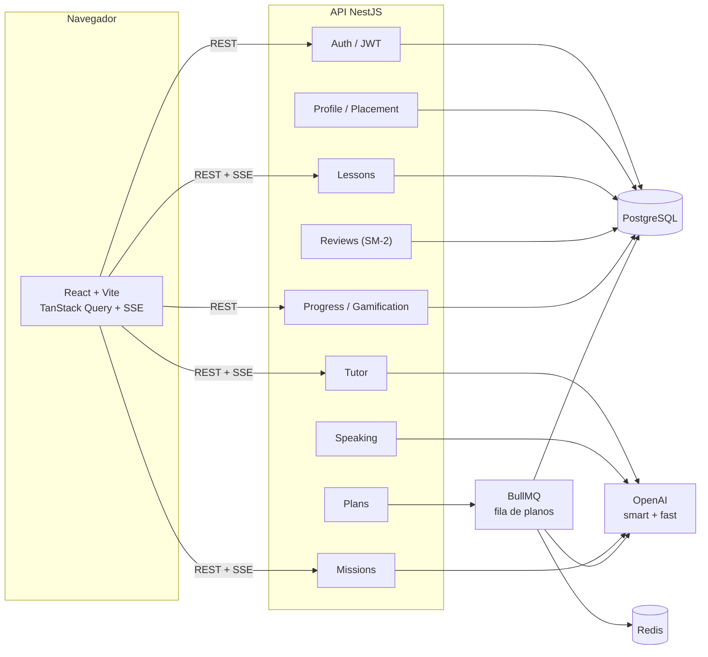
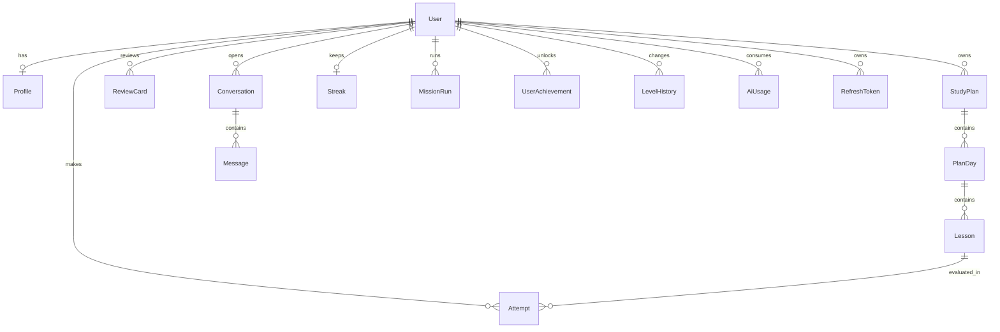
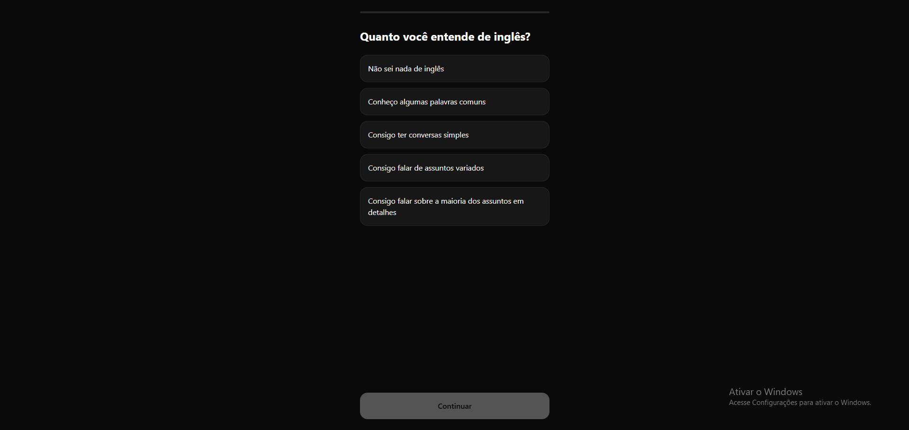
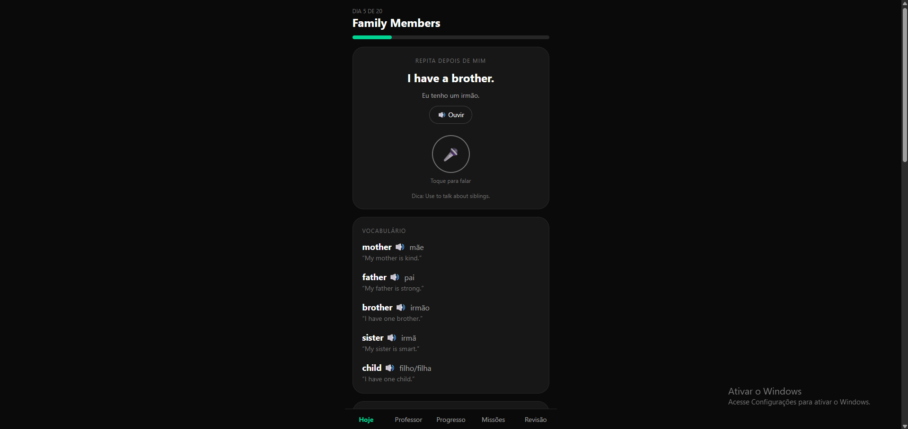
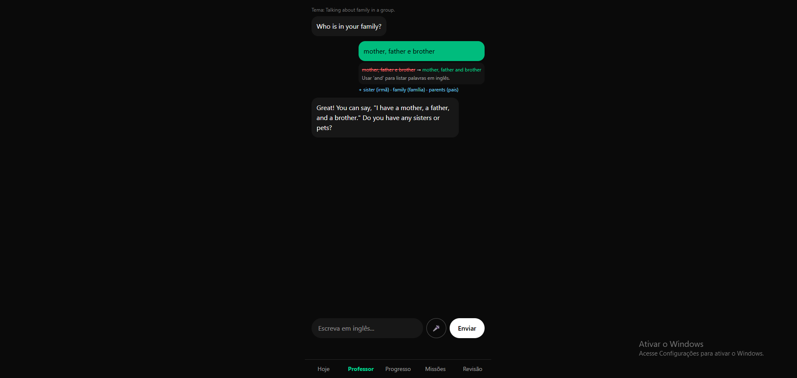

# Fluentify

Plataforma de aprendizado de inglês para brasileiros que combina **professor de IA**, **plano de estudos personalizado**, **prática de fala com feedback** e **repetição espaçada**.

O objetivo é resolver o problema de quem estuda sozinho: em vez de conteúdo genérico, o aluno recebe um plano adaptado ao nível e ao tempo disponível, conversa com um tutor que responde em streaming, recebe correções estruturadas e revisa automaticamente o que errou.

> Projeto full-stack desenvolvido como estudo aprofundado de arquitetura, integração com LLMs, algoritmos de aprendizado e segurança de APIs.

Quando o repositório estiver publicado no GitHub, descomente e troque OWNER/REPO:
[](https://github.com/OWNER/REPO/actions/workflows/ci.yml)


---

## Índice

- [Visão geral](#visão-geral)
- [Funcionalidades](#funcionalidades)
- [Arquitetura](#arquitetura)
- [Stack](#stack)
- [Estrutura do repositório](#estrutura-do-repositório)
- [Como rodar localmente](#como-rodar-localmente)
- [Credenciais de demonstração](#credenciais-de-demonstração)
- [Variáveis de ambiente](#variáveis-de-ambiente)
- [API](#api)
- [Modelo de dados](#modelo-de-dados)
- [Decisões de engenharia](#decisões-de-engenharia)
- [Testes e qualidade](#testes-e-qualidade)
- [CI](#ci)
- [Roadmap e limitações](#roadmap-e-limitações)
- [Screenshots](#screenshots)

---

## Visão geral

O fluxo principal do produto:

1. **Onboarding** — o aluno informa objetivo, tempo por dia, dias por semana e faz um **mini teste de nivelamento** (10 perguntas). O nível final é o **menor** entre o autodeclarado e o testado, para evitar frustração no primeiro dia.
2. **Plano de estudos** — um job assíncrono (BullMQ) usa IA para gerar semanas de estudo, cada dia com lições de fala, vocabulário e conversa.
3. **Prática diária** — exercício de fala com reconhecimento de voz, cartões de vocabulário e um chat com o professor.
4. **Feedback** — o chat responde em streaming e, em paralelo, um analisador devolve correções estruturadas (`original → corrigido + explicação`).
5. **Revisão** — palavras e frases erradas viram cartões no algoritmo **SM-2**.
6. **Evolução** — XP, conquistas, streak com congelador, meta semanal, missões de role-play e recalibragem automática de nível.

---

## Funcionalidades

### Autenticação e conta
- Cadastro e login com e-mail/senha (**bcrypt**).
- **Google Sign-In** (opcional, via `GOOGLE_CLIENT_ID`).
- Access token JWT curto (15 min) mantido **em memória** no front.
- Refresh token em **cookie HttpOnly** com rotação, detecção de reuso e revogação de todas as sessões.
- Recuperação de senha por e-mail (Resend) com token de uso único e expiração.

### Nivelamento e plano
- Mini teste público (roda antes do cadastro) com gabarito **somente no servidor**.
- Geração de plano via fila **BullMQ** com retry/backoff.
- Acompanhamento do job por `GET /plans/jobs/:id`.
- Recalibragem automática: média ≥ 90 sobe o nível, ≤ 40 desce, com histórico em `LevelHistory`.

### Prática de fala
- Exercício com **Web Speech API** (reconhecimento e síntese de voz).
- Alinhamento por **LCS** (Longest Common Subsequence) para comparar frase esperada e transcrição.
- Nota por palavra (certa/errada), dica gerada por IA somente quando necessário (economia de tokens).
- Frases com nota **< 80%** viram cartão de revisão automaticamente.

### Chat e correção estruturada
- Resposta do professor em **SSE (streaming)**.
- Analisador roda **em paralelo** com o modelo rápido e devolve `corrections` + `newWords` validados com **Zod**.
- Correções aparecem abaixo do balão do aluno e alimentam a revisão espaçada.
- Quotas diárias por funcionalidade e registro de tokens em `AiUsage`.

### Repetição espaçada
- Algoritmo **SM-2** (o mesmo do Anki) em função pura e testável.
- Cartões gerados automaticamente por vocabulário concluído, fala ruim e correções do chat.
- Deduplicação por `(userId, front)` e fila de revisão por `dueAt`.

### Gamificação
- XP por dia concluído, fala ≥ 90% (somente na primeira vez por exercício) e missões.
- Nível do jogador calculado por `floor(sqrt(xp / 100)) + 1`.
- Conquistas (`UserAchievement`), streak com **congelador** e fuso horário por usuário.
- Meta semanal e grade de conquistas na tela de progresso.

### Missões de role-play
- Catálogo com cenário, personagem e objetivos.
- Conversa com o mesmo motor do tutor, mas com prompt de role-play.
- Avaliação final por IA: objetivos cumpridos, nota e feedback.
- Missões bloqueadas por nível mínimo.

### Operação e segurança
- Filtro por `userId` em todas as leituras/escritas (anti-IDOR).
- `ValidationPipe` global com `whitelist` e `transform`.
- Throttling global e limites específicos em rotas caras.
- Logs estruturados com `pino`, ocultando `authorization` e `cookie`.
- Sentry para erros (API e web).
- Health check em `GET /health`.
- Dashboard de filas (Bull Board) em `/queues` protegido por Basic Auth.

---

## Arquitetura



**Separação de responsabilidades:** a API é modular (um módulo Nest por domínio), o front é uma SPA React consumindo REST + SSE, e tarefas caras de IA rodam fora do ciclo de request quando possível (fila de planos).

---

## Stack

| Camada | Tecnologias |
|---|---|
| **Backend** | NestJS 12, TypeScript 6, Prisma 6, PostgreSQL 16 |
| **Autenticação** | JWT, Passport, bcrypt, Google Auth Library |
| **IA** | OpenAI (chat completions, streaming, JSON mode), Zod |
| **Assíncrono** | BullMQ + Redis |
| **Frontend** | React 19, Vite 8, TanStack Query 5, React Router 7, Tailwind CSS 4 |
| **Voz** | Web Speech API (SpeechRecognition + SpeechSynthesis) |
| **Observabilidade** | Sentry, nestjs-pino, `@nestjs/observe` |
| **E-mail** | Resend |
| **Qualidade** | Vitest, oxlint, ESLint, GitHub Actions |
| **Infra local** | Docker Compose (Postgres + Redis) |

---

## Estrutura do repositório

```text
Fluentify/
├─ english-api/                 # API NestJS
│  ├─ prisma/
│  │  ├─ schema.prisma          # modelos e enums
│  │  ├─ migrations/            # histórico versionado
│  │  └─ seed.ts                # dados de demonstração
│  ├─ src/
│  │  ├─ ai/                    # OpenAI, quotas, custo
│  │  ├─ auth/                  # JWT, Google, refresh tokens
│  │  ├─ placement/             # mini teste de nivelamento
│  │  ├─ plans/                 # geração assíncrona de plano
│  │  ├─ lessons/               # dia atual, conclusão
│  │  ├─ speaking/              # avaliação de fala, LCS
│  │  ├─ tutor/                 # chat + análise estruturada
│  │  ├─ missions/              # role-play
│  │  ├─ reviews/               # SM-2
│  │  ├─ progress/              # streak, pontos fracos
│  │  ├─ gamification/          # XP e conquistas
│  │  ├─ profile/               # perfil + recalibragem
│  │  ├─ generated/prisma/      # client gerado (não versionado)
│  │  └─ common/                # SSE, fuso, decorators
│  └─ docker-compose.yml        # Postgres + Redis
│
├─ english-web/                 # SPA React
│  └─ src/
│     ├─ pages/                 # Onboarding, Home, Tutor, Progress, Review, Missions...
│     ├─ components/            # ChatView, SpeakingExercise, CelebrationModal...
│     ├─ hooks/                 # useSpeechRecognition, usePlanJob
│     ├─ lib/                   # axios, tipos, speech
│     └─ auth/                  # contexto e rota protegida
│
├─ .github/workflows/ci.yml     # lint + build + testes + migrations
└─ README.md
```

---

## Como rodar localmente

### Pré-requisitos

- **Node.js 24+**
- **npm**
- **Docker** e **Docker Compose**
- Chave da **OpenAI** (necessária para gerar plano, chat, missões e dicas de IA)

### 1. Subir Postgres e Redis

```bash
cd english-api
docker compose up -d
```

Isso expõe Postgres em `localhost:5433` e Redis em `localhost:6379`.

### 2. Rodar a API

```bash
cd english-api
cp .env.example .env
# edite o .env: DATABASE_URL, JWT_SECRET e OPENAI_API_KEY são os principais
npm ci
npx prisma migrate dev
npm run db:seed
npm run start:dev
```

A API sobe em `http://localhost:3000`.

### 3. Rodar o front

```bash
cd english-web
cp .env.example .env
# VITE_API_URL=http://localhost:3000
npm ci
npm run dev
```

A SPA sobe em `http://localhost:5173`.

> Sem uma `OPENAI_API_KEY` válida, o login e o conteúdo já seedado funcionam, mas geração de plano, chat, missões e dicas de IA vão falhar.
>
> Para recuperação de senha, se não houver `RESEND_API_KEY` ou o envio falhar, a API imprime o conteúdo do e-mail no console em desenvolvimento. Copie o link `/reset?token=...` de lá.

---

## Credenciais de demonstração

O seed cria um aluno pronto para explorar o produto:

| Campo | Valor |
|---|---|
| E-mail | `demo@fluentify.app` |
| Senha | `demo12345` |

O usuário demo já vem com:

- perfil **INTERMEDIATE**, objetivo **CONVERSATION**, 10 min/dia, 5 dias/semana;
- plano ativo de **7 dias** (21 lições) com o primeiro dia concluído;
- **5 cartões** de revisão vencidos;
- **5 tentativas** de fala (para o gráfico e para os pontos fracos);
- streak de **3 dias** com 1 congelador;
- **250 XP** e 2 conquistas.

O seed é **idempotente**: pode ser executado novamente sem duplicar dados.

---

## Variáveis de ambiente

### API (`english-api/.env`)

| Variável | Obrigatória | Descrição |
|---|---|---|
| `DATABASE_URL` | ✅ | String de conexão do PostgreSQL |
| `JWT_SECRET` | ✅ | Segredo para assinar o access token |
| `OPENAI_API_KEY` | ✅ (IA) | Chave da OpenAI |
| `OPENAI_MODEL` | — | Modelo "smart" (padrão `gpt-4.1`) |
| `OPENAI_MODEL_FAST` | — | Modelo "fast" para análise/dicas (padrão `gpt-4.1-mini`) |
| `FRONTEND_URL` | ✅ | Origem liberada no CORS |
| `REDIS_HOST` / `REDIS_PORT` | ✅ | Conexão do BullMQ |
| `PORT` | — | Porta da API (padrão `3000`) |
| `NODE_ENV` | — | `development` / `production` |
| `SENTRY_DSN` | — | Erros no Sentry |
| `RESEND_API_KEY` / `MAIL_FROM` | — | Recuperação de senha |
| `GOOGLE_CLIENT_ID` | — | Login com Google |
| `AI_DAILY_TOKEN_ALERT` | — | Limite para alerta de consumo |
| `DASHBOARD_USER` / `DASHBOARD_PASS` | — | Basic Auth do Bull Board (`/queues`) |

### Web (`english-web/.env`)

| Variável | Obrigatória | Descrição |
|---|---|---|
| `VITE_API_URL` | ✅ | URL da API (ex.: `http://localhost:3000`) |
| `VITE_GOOGLE_CLIENT_ID` | — | Client ID do Google Sign-In |
| `VITE_SENTRY_DSN` | — | Erros no Sentry |

---

## API

Base local: `http://localhost:3000`. Rotas marcadas com 🔒 exigem `Authorization: Bearer <accessToken>`.

### Autenticação

| Método | Rota | Descrição |
|---|---|---|
| `POST` | `/auth/register` | Cria conta e devolve access token + cookie de refresh |
| `POST` | `/auth/login` | Login com e-mail/senha |
| `POST` | `/auth/google` | Login com credencial do Google |
| `POST` | `/auth/refresh` | Rotaciona o refresh token |
| `POST` | `/auth/logout` | Revoga o refresh token |
| `POST` | `/auth/forgot` | Envia e-mail de recuperação |
| `POST` | `/auth/reset` | Redefine a senha |

### Perfil e nivelamento

| Método | Rota | Descrição |
|---|---|---|
| `GET/PUT` | `/profile` 🔒 | Lê/atualiza perfil e fuso |
| `GET` | `/placement/questions` | Perguntas do teste (sem gabarito) |
| `POST` | `/placement/submit` | Corrige o teste e devolve o nível |

### Plano e lições

| Método | Rota | Descrição |
|---|---|---|
| `POST` | `/plans/generate` 🔒 | Enfileira a geração do plano |
| `GET` | `/plans/jobs/:id` 🔒 | Status do job |
| `GET` | `/plans/active` 🔒 | Plano ativo |
| `GET` | `/lessons/today` 🔒 | Dia atual com lições |
| `POST` | `/lessons/days/:id/complete` 🔒 | Conclui o dia (cartões, streak, XP, nível) |

### Fala, chat e revisão

| Método | Rota | Descrição |
|---|---|---|
| `POST` | `/speaking/evaluate` 🔒 | Avalia a fala (LCS) e gera dica/XP |
| `POST` | `/tutor/message` 🔒 | Chat do professor em **SSE** |
| `GET` | `/reviews/due` 🔒 | Cartões vencidos |
| `POST` | `/reviews/:id/grade` 🔒 | Avalia um cartão (SM-2) |

### Progresso, missões e saúde

| Método | Rota | Descrição |
|---|---|---|
| `GET` | `/progress` 🔒 | Resumo, XP, meta semanal e conquistas |
| `GET` | `/progress/weak-points` 🔒 | Palavras mais erradas |
| `POST` | `/progress/practice` 🔒 | Gera frases sob medida |
| `GET` | `/missions` 🔒 | Lista de missões |
| `POST` | `/missions/:id/start` 🔒 | Inicia uma missão |
| `POST` | `/missions/runs/:runId/message` 🔒 | Chat da missão em **SSE** |
| `POST` | `/missions/runs/:runId/finish` 🔒 | Avalia a missão |
| `GET` | `/health` | Health check (banco) |

**Formato SSE:** cada evento é `data: {json}\n\n` com `type` em `meta`, `delta`, `analysis`, `done` ou `error`.

---

## Modelo de dados



Destaques:

- `Lesson.content` é **JSON** e varia por tipo (`SPEAKING`, `VOCAB`, `CHAT`).
- `Message.analysis` guarda a correção estruturada daquela mensagem.
- `ReviewCard` tem índice único `(userId, front)` para evitar duplicatas.
- `AiUsage` agrega tokens por `(userId, dia, feature)` para quotas e custo.
- `LevelHistory` registra cada recalibragem com a média que a motivou.

---

## Decisões de engenharia

**Por que SM-2?** É simples, determinístico e comprovado. A função pura `sm2()` é fácil de testar e não depende de banco. Acertou fácil → intervalo cresce; errou → volta para 1 dia.

**Por que a análise roda em paralelo?** O aluno não deve esperar a IA "professora" terminar para receber a resposta. O tutor usa o modelo forte em streaming e, ao mesmo tempo, um modelo rápido analisa a mensagem. No fim, o evento `analysis` chega quase de graça em latência.

**Por que XP só na primeira vez?** Gamificação é fácil de vazar. Dar XP toda vez que alguém repete a mesma frase permitiria farmar pontos. O bônus de fala exige `score ≥ 90` e verifica se já houve um acerto ≥ 90 naquele `lessonId`.

**Por que o nível final é o menor?** Entre o autodeclarado e o testado, começar um pouco fácil é melhor do que frustrar. A recalibragem sobe o nível rápido quando o desempenho é bom.

**Streak com fuso e congelador.** O "dia" usa o fuso do aluno (com fallback seguro), e faltar exatamente um dia consome um congelador em vez de zerar. Ganha-se um congelador a cada 7 dias, com máximo de 2.

**Segurança de sessão.** Access token de 15 min fica só em memória; o refresh token é um cookie HttpOnly restrito a `/auth`, com rotação. Se um token já revogado for reapresentado, todas as sessões do usuário são derrubadas.

**Custo de IA.** Cada feature tem quota diária (`tutor`, `tip`, `plan`, `analysis`, `mission`), o consumo é registrado em `AiUsage`, e há alerta por volume de tokens.

**Validação de JSON da IA.** `AiService.json()` usa `response_format: json_object`, remove cercas de código, valida com **Zod** e tenta novamente com backoff — evitando que um JSON malformado quebre o fluxo.

---

## Testes e qualidade

```bash
# API
cd english-api
npm run lint       # oxlint
npm test           # Vitest (SM-2, LCS, streak)
npm run build      # nest build

# Web
cd english-web
npm run lint       # ESLint
npm run build      # tsc -b && vite build
```

- **15 testes unitários** cobrindo as regras puras mais críticas (SM-2, alinhamento de fala e streak).
- Testes de avaliação de IA ficam **opt-in** (`RUN_EVALS=1`) por custo e dependência de chave.
- Typecheck rigoroso nos dois projetos.

---

## CI

O workflow [`.github/workflows/ci.yml`](.github/workflows/ci.yml) roda em `push` para `main` e em pull requests:

**API**
1. sobe um Postgres 16 como service;
2. `npm ci`, `prisma generate`, `prisma migrate deploy`;
3. executa o seed (smoke test);
4. `lint`, `build` e `test`.

**Web**
1. `npm ci`;
2. `lint`;
3. `build`.

---

## Roadmap e limitações

- **Sem deploy público ainda.** O projeto roda localmente com Docker Compose; um próximo passo é publicar API + banco + front (Railway/Fly.io + Vercel/Netlify).
- **Cobertura de testes concentrada em funções puras.** Falta ampliar e2e das rotas principais e testes de componentes no front.
- **Dependência de chave paga da OpenAI** para as features de IA.
- **`@nestjs/observe`** está configurado com chaves placeholder — deve ser desativado ou configurado em produção.
- **Bull Board** usa Basic Auth com credenciais padrão de desenvolvimento; troque em produção.
- **Evolução da agregação de pontos fracos:** hoje é feita em memória sobre as últimas 100 tentativas; com volume maior, migrar para SQL (`jsonb_array_elements`) ou uma tabela `WordStat`.

---

## Screenshots

As imagens ficam em `docs/screenshots/`. Descomente o bloco abaixo depois de adicioná-las:

| Onboarding |
|---|
|  |

| Home |
|---|
|  |

| Tutor |
|---|
|  |


---

## Licença

Projeto privado, desenvolvido para fins de estudo e portfólio. Todos os direitos reservados.
